# 麦轮小车参数测量图解

> ⚠ **编号已失效**：本文里的 `#N` 编号对应 v1 版清单。清单已重排为《必需参数（标量）／四轮参数表／一次性检查／PID整定与验收／附录》，
> 现在请按「参数名称」或必需参数表最后一列「参考图」来对应。图本身（怎么量、量哪里）全部仍然有效。

> 配套《麦轮小车参数测量清单.xlsx》使用。
> 量之前先看图，再动手，可以避免绝大多数"量错对象"的问题。
>
> 所有图的源文件在 `测量示意图/` 文件夹（PNG 为 2 倍分辨率，可放大看细节）。

## 图号总索引

| 图号 | 内容 | 覆盖清单条目 |
|---|---|---|
| 图1 | 坐标系与轮序（俯视） | #5–#9 |
| 图2 | 整车外形尺寸（俯视+侧视） | #1–#4 |
| 图3 | 轴距、轮距与轮心偏移（俯视） | #14–#18 |
| 图4 | **轮子悬出量：量哪里（重点）** | #19 |
| 图5 | 四轮共面检查与静态载荷 | #20–#22、#56–#58 |
| 图6 | 底盘板层与层间距 | #11–#13 |
| 图7 | 电机安装精度（垂直度/跳动/同轴） | #23、#38–#40 |
| 图8 | 轮子外径 D 与轮宽 t | #25、#27、#28 |
| 图9 | 辊子几何参数（β、e、d_r、p_r） | #29–#35 |
| 图10 | 麦轮布局判定：X 型 / O 型 | #10、#36、#37 |
| 图11 | 质量分布与质心计算 | #41–#54、#59–#61 |
| 图12 | 质心高度：双线悬吊法 | #55 |
| 图13 | 电机铭牌 / PWM 死区与线性度 | #62–#74 |
| 图14 | 编码器：单圈计数与每米计数标定 | #75–#86 |
| 图15 | IMU（GY-25T）安装与零偏 | #87–#100 |
| 图16 | 供电与电压跌落测量 | #101–#110 |
| 图17 | 运动性能测试场地布置 | #121–#131 |

---

## 图1 · 坐标系与轮序（俯视）

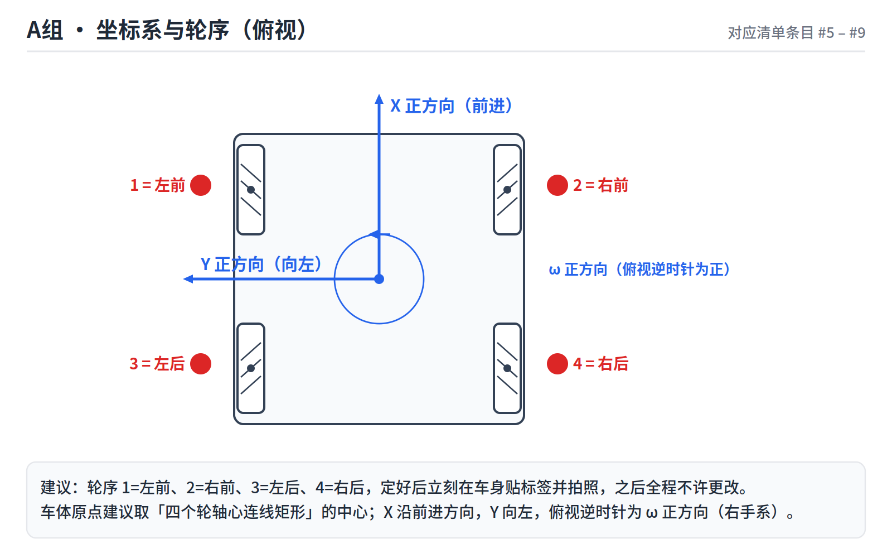

- 轮序建议 **1=左前、2=右前、3=左后、4=右后**，定好后立刻贴标签拍照，之后全程不得更改。
- 车体原点建议取**四个轮轴心连线矩形的中心**；X 沿前进方向、Y 向左、俯视逆时针为 ω 正方向（右手系）。
- 这组是"约定"不是"测量"，但**必须写进报告**——之后所有方程的符号都依赖它。

## 图2 · 整车外形尺寸

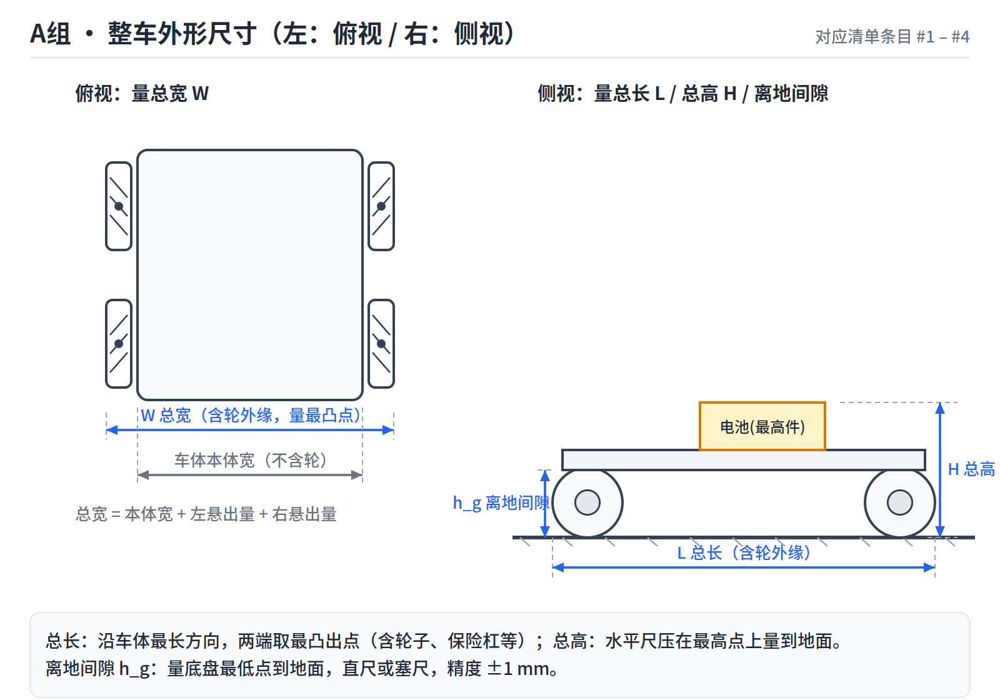

- 总长 L：沿最长方向、两端取**最凸出点**（含轮子、凸出的螺丝等）。
- 总宽 W：含轮外缘；注意与"车体本体宽"分开记录，两者差 = 左右悬出量（见图4）。
- 总高 H：水平尺压最高点量到地面；离地间隙 h_g：底盘最低点到地面，±1 mm。

## 图3 · 轴距、轮距与轮心偏移

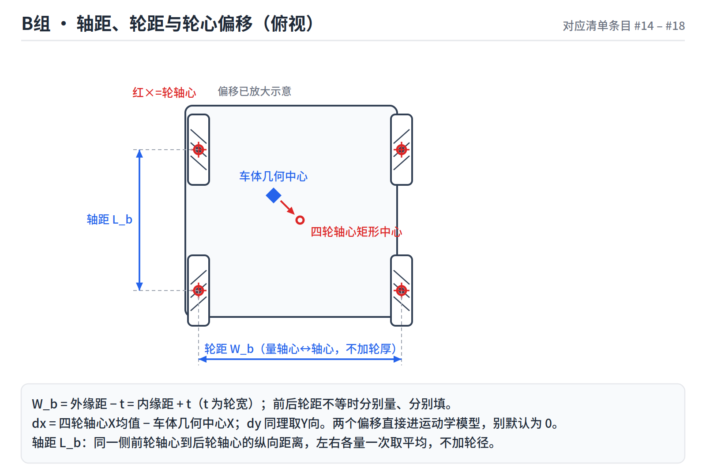

- **都量轴心，不加轮厚/轮径**：W_b = 外缘距 − t = 内缘距 + t，可用两种量法交叉验证。
- 轴距 L_b 左右两侧各量一次取平均；前后轮距不等时分别填。
- dx / dy（轮心均值相对车体几何中心的偏移）**直接进运动学模型**，不要默认为 0。

## 图4 · 轮子悬出量（你的问题的答案）

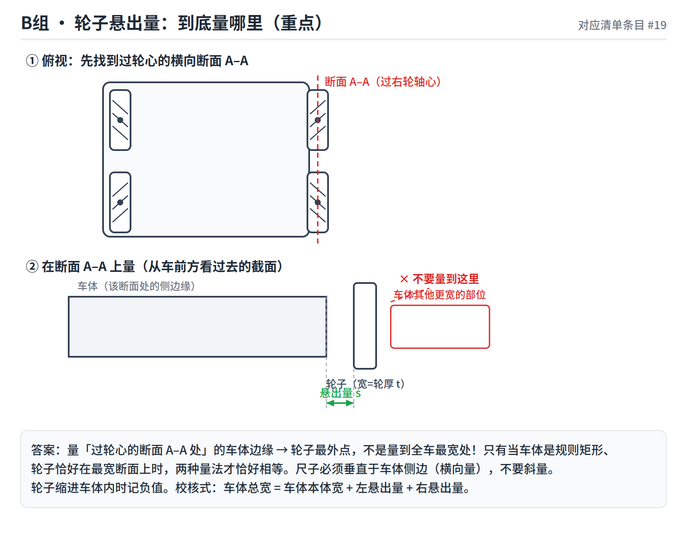

**结论：量"过轮心的横向断面 A–A 处"的车体边缘到轮子最外点，不是量到全车最宽处。**

- 两种理解的区别：只有当车体是规则矩形、且轮子恰好装在最宽断面上时，"该处边缘"和"最宽处"才重合；
  只要车体前后宽度不同、或侧面有凸出的安装座/电机，就必须**在轮子所在的断面量**。
- 尺子要**垂直于车体侧边**（横向量），不要斜量。
- 轮子缩进车体内时记**负值**。
- 校核式：`车体总宽 = 车体本体宽 + 左悬出量 + 右悬出量`。

## 图5 · 四轮共面与静态载荷

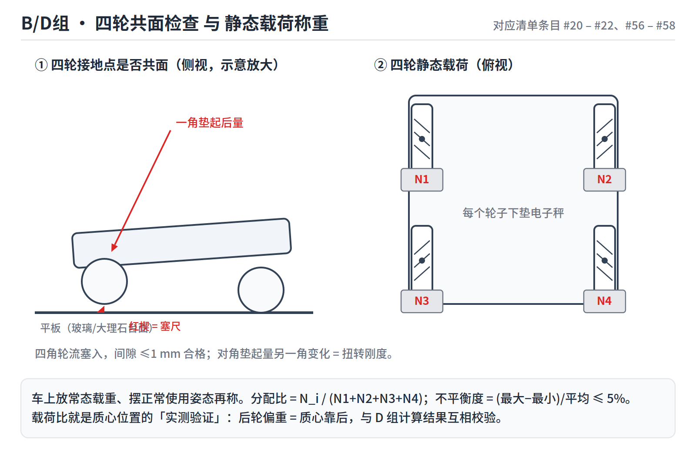

- 平板上四角轮流塞塞尺，间隙 ≤1 mm 合格；对角垫起量另一角变化 = 扭转刚度。
- 称重时车上放**常态载重、摆正常姿态**；分配比 = N_i/ΣN，不平衡度 = (最大−最小)/平均 ≤5%。
- 载荷比是质心计算的**实测交叉验证**：后轮偏重 = 质心靠后。

## 图6 · 底盘板层与层间距

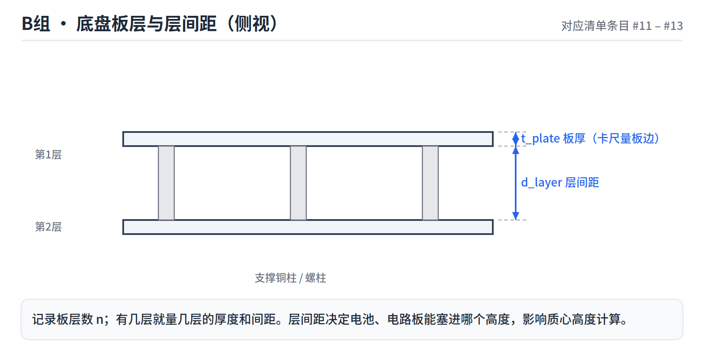

- 几层板就量几层的厚度（卡尺量板边）与层间距（铜柱/螺柱长度）。
- 层间距决定电池、电路板能放的高度，影响质心高度 z_c 的计算。

## 图7 · 电机安装精度

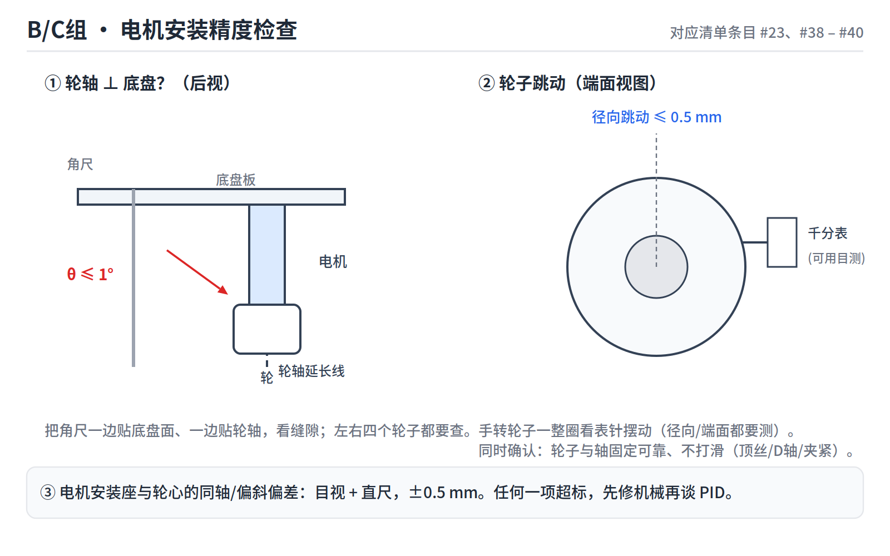

- 轮轴 ⊥ 底盘 ≤1°（角尺贴查，四个轮子都要查）；轮子跳动 ≤0.5 mm（千分表或目测）。
- 电机安装座与轮心同轴偏差 ±0.5 mm。
- 任何一项超标，**先修机械再谈 PID**——机械误差是软件补不回来的。

## 图8 · 轮子外径与轮宽

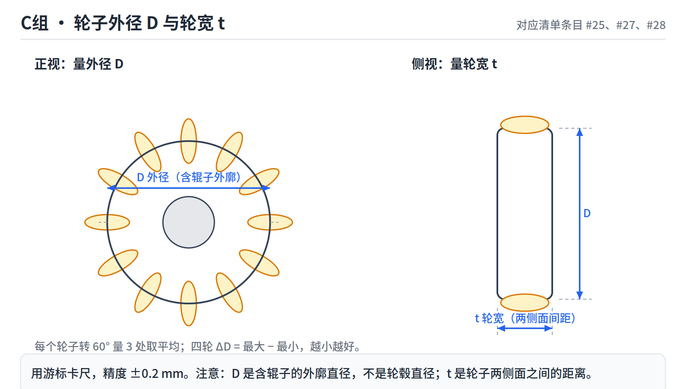

- D 是**含辊子的外廓直径**，不是轮毂直径；每轮转 60° 量 3 处取平均，±0.2 mm。
- 四轮 ΔD = 最大 − 最小，记录下来；t 为两侧面间距。

## 图9 · 辊子几何参数

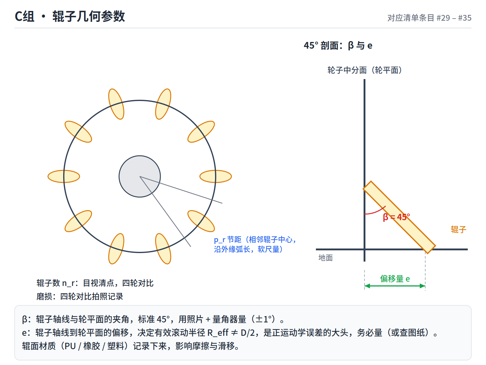

- β（辊子轴线与轮平面夹角）：照片 + 量角器，标准 45°，±1°。
- e（辊子轴线到轮平面的偏移）：决定有效滚动半径 **R_eff ≠ D/2**，是正运动学误差的大头。
- 顺手记录：每轮辊子数、辊面材质（PU/橡胶/塑料）、四轮磨损对比。

## 图10 · 麦轮布局判定

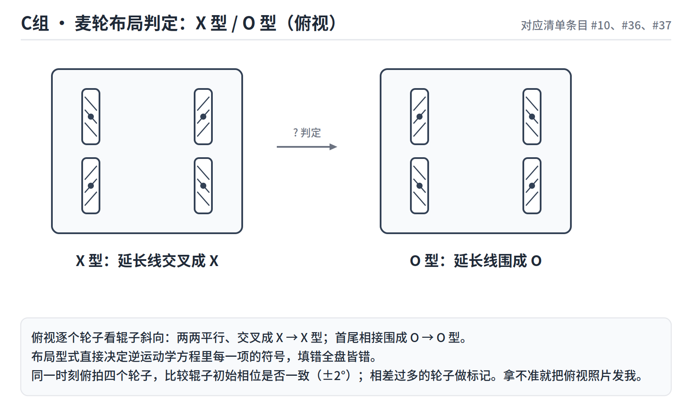

- 俯视看辊子斜向：交叉成 X → X 型；围成 O → O 型。**填错符号全盘皆错**。
- 同一时刻俯拍四轮比较辊子初始相位（±2°）。拿不准就发照片来，我帮你判。

## 图11 · 质量分布与质心计算

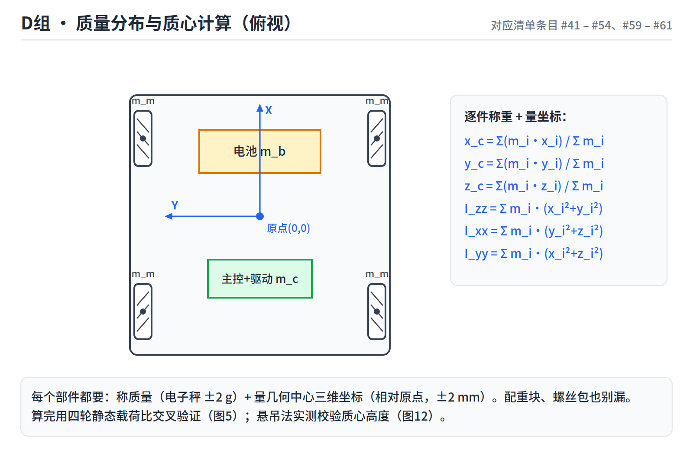

- 每个部件：称质量（±2 g）+ 量几何中心三维坐标（相对原点，±2 mm）；配重块、螺丝包别漏。
- 公式见图中面板；算完用图5载荷比、图12悬吊法双重验证。

## 图12 · 质心高度：悬吊法

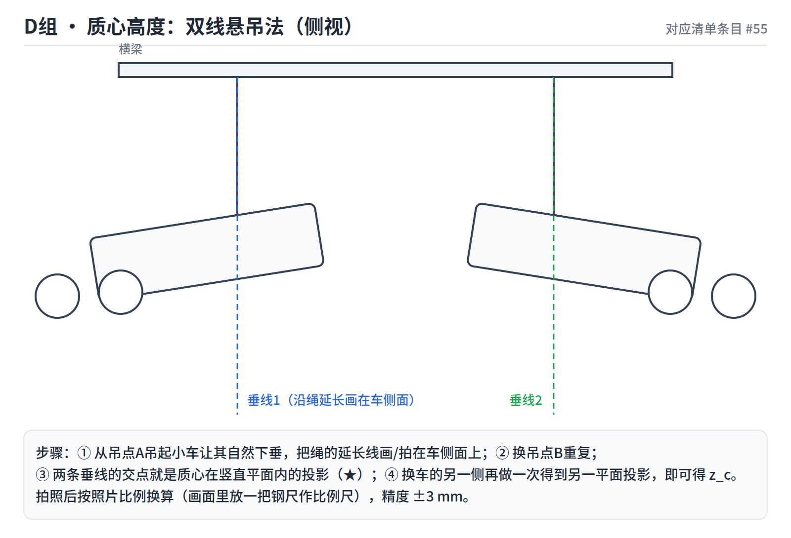

- 两个吊点各吊一次，把绳的延长线画/拍在车侧面上；两垂线交点 = 质心投影。
- 换另一侧再做一次得另一平面投影 → z_c；照片里放钢尺作比例，±3 mm。

## 图13 · 电机铭牌 / PWM 死区与线性度

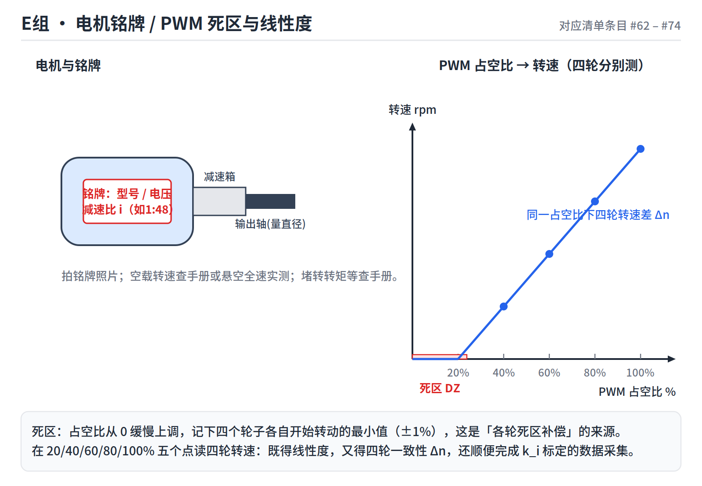

- 拍铭牌（型号/电压/减速比）；空载转速查手册或悬空全速实测。
- 死区：占空比从 0 缓慢上调，记四轮各自起转的最小值（±1%）→ 各轮死区补偿。
- 20/40/60/80/100% 五点读四轮转速：线性度 + 四轮差 Δn + 顺带采 k_i 标定数据。

## 图14 · 编码器标定

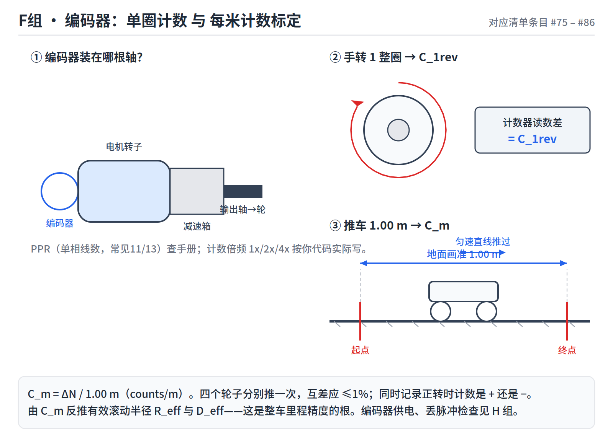

- 先确认编码器装在**电机轴**还是**减速输出轴**（拍照记录），PPR 查手册，倍频按代码实际写。
- 手转 1 整圈 → C_1rev；地面画准 1.00 m 匀速推车 → C_m（counts/m），四轮各做一次互差 ≤1%。
- 记录正转时计数 +/−；由 C_m 反推 R_eff / D_eff——整车里程精度的根。

## 图15 · IMU 安装与零偏

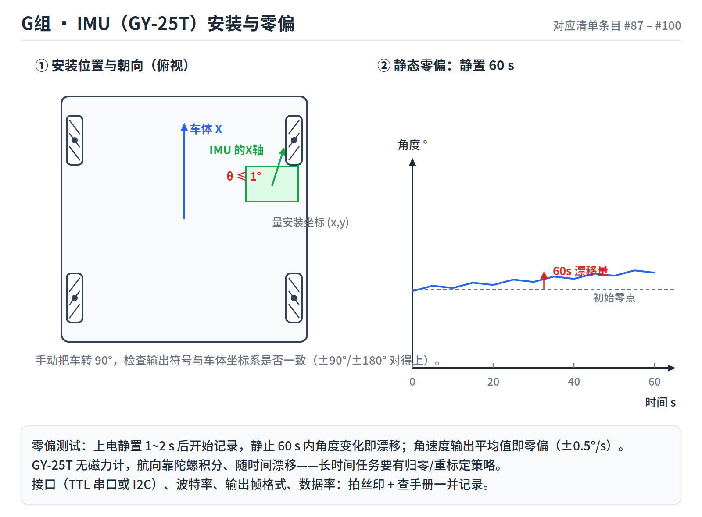

- 安装偏角 ≤1°（IMU 轴与车体轴）；手动转 90° 检查输出符号与车体坐标系一致。
- 静置 60 s 记角度漂移；角速度输出平均值 = 零偏（±0.5°/s）。
- GY-25T 无磁力计：航向靠积分、随时间漂移，长时间任务要有归零策略。

## 图16 · 供电与电压跌落

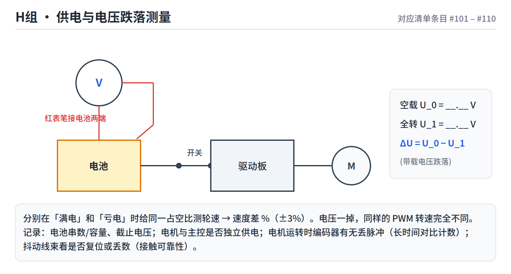

- 空载 U_0、电机全转 U_1，ΔU = U_0 − U_1 必须记录。
- 满电 vs 亏电同一占空比测轮速 → 速度差 %（±3%）。
- 电机运转时长时间对比编码器计数，查丢脉冲；抖动线束查接触。

## 图17 · 运动测试场地布置

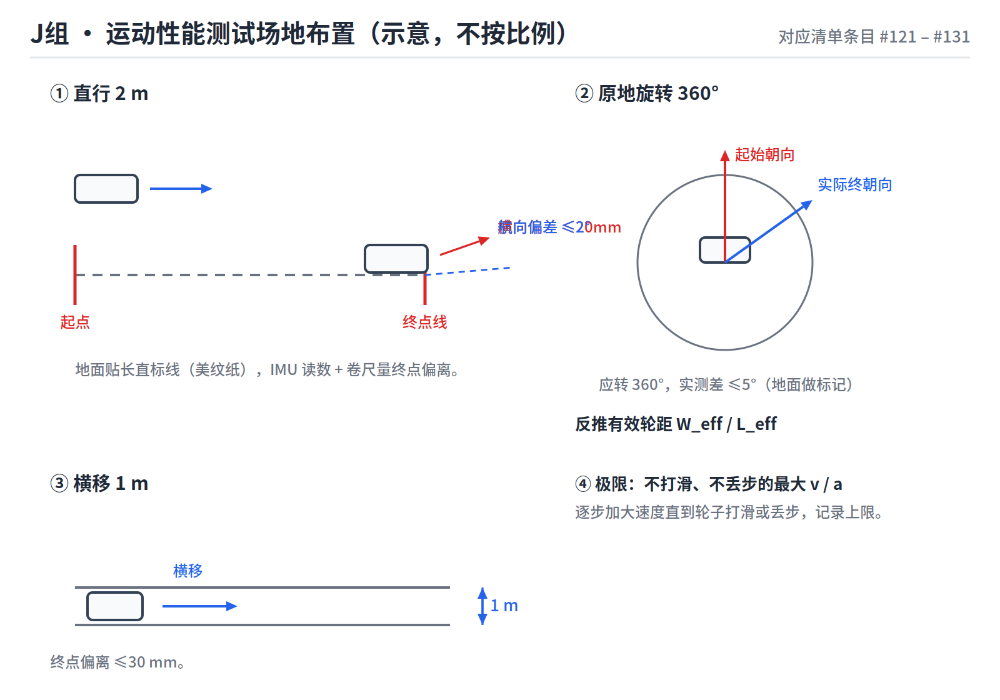

- 直行 2 m：横向偏差 ≤20 mm、航向偏差 ≤2°（地面贴美纹纸标线）。
- 原地旋转 360°：实测转角差 ≤5° → 反推有效轮距 W_eff / L_eff。
- 横移 1 m：偏差 ≤30 mm；逐步加速到打滑/丢步，记录 v_max / a_max。

---

## 建议的测量顺序

1. **先约定后测量**：图1（坐标系/轮序）→ 贴标签。
2. **几何一组**：图2、3、4、6、8、9（一把卷尺 + 一把卡尺 + 量角器全搞定）。
3. **质量一组**：图11、12、5（电子秤）。
4. **上电静态**：图13（死区/转速）、图14（编码器标定）、图15（IMU）、图16（电压）。
5. **装机检查**：图7、10。
6. **最后跑测试**：图17，把结果填回清单 J 组，我们再开始整定 PID。

有拿不准的量法，拍照发我即可。
